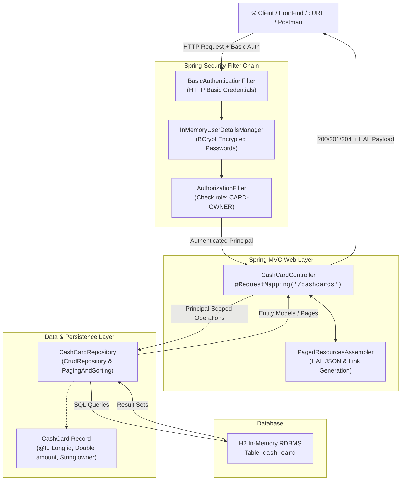
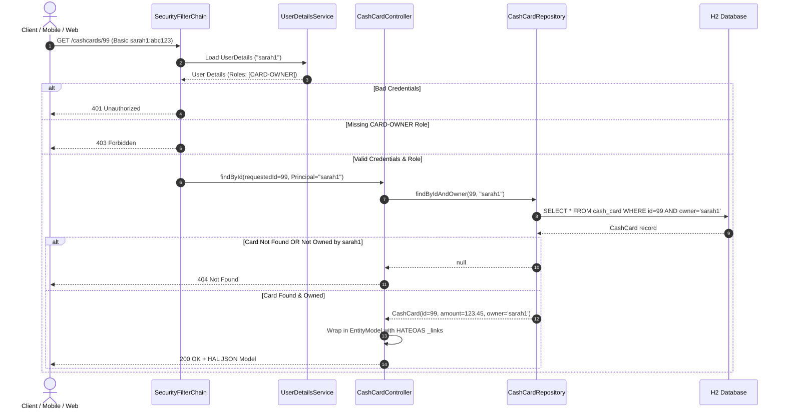
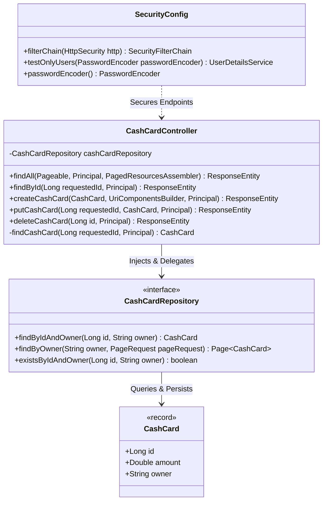
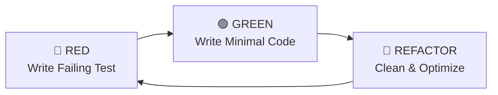

# 💳 CashCard REST API

[](https://www.oracle.com/java/technologies/javase/jdk17-archive-downloads.html)
[](https://spring.io/projects/spring-boot)
[](https://spring.io/projects/spring-security)
[](https://spring.io/projects/spring-data-jdbc)
[](https://www.h2database.com/)
[](https://gradle.org/)
[](LICENSE)
[](#testing-strategy)

A robust, enterprise-ready **RESTful API** built with **Java 17** and **Spring Boot 3** to manage personal and family cash cards. Developed following strict **Test-Driven Development (TDD)** principles, the service features multi-tenant data isolation, role-based access control (RBAC), HATEOAS hypermedia-driven representations, and dynamic pagination and sorting.

---

## 📑 Table of Contents

- [Overview](#overview)
- [Key Features](#key-features)
- [System Architecture](#system-architecture)
  - [High-Level Architecture](#high-level-architecture)
  - [Request Lifecycle & Security Flow](#request-lifecycle--security-flow)
  - [Component Architecture](#component-architecture)
- [Data Model & Schema](#data-model--schema)
- [Security & Access Control](#security--access-control)
  - [Role-Based Access Control (RBAC)](#role-based-access-control-rbac)
  - [Data Ownership Isolation](#data-ownership-isolation)
  - [Pre-Configured Demo Accounts](#pre-configured-demo-accounts)
- [API Reference](#api-reference)
  - [Endpoints Summary](#endpoints-summary)
  - [1. List Cash Cards (Paginated & Sorted)](#1-list-cash-cards-paginated--sorted)
  - [2. Get Cash Card by ID](#2-get-cash-card-by-id)
  - [3. Create New Cash Card](#3-create-new-cash-card)
  - [4. Update Existing Cash Card](#4-update-existing-cash-card)
  - [5. Delete Cash Card](#5-delete-cash-card)
- [Hypermedia (HATEOAS) & Pagination](#hypermedia-hateoas--pagination)
- [Tech Stack](#tech-stack)
- [Getting Started](#getting-started)
  - [Prerequisites](#prerequisites)
  - [Installation & Build](#installation--build)
  - [Running the Application](#running-the-application)
- [Testing Strategy](#testing-strategy)
  - [Unit & JSON Contract Testing](#unit--json-contract-testing)
  - [End-to-End Integration Testing](#end-to-end-integration-testing)
  - [Executing Tests](#executing-tests)
- [Project Structure](#project-structure)
- [Roadmap & Enhancements](#roadmap--enhancements)
- [Author & License](#author--license)

---

## 🌟 Overview

The **CashCard Service** provides an isolated card-management platform where authorized users can create, retrieve, update, and delete their family allowance or cash balance cards.

Unlike basic CRUD implementations, this application enforces strict multi-tenant ownership boundaries at the data layer, integrates Spring HATEOAS for discoverable REST APIs (Richardson Maturity Model Level 3), and provides automatic sorting and pagination backed by Spring Data JDBC.

---

## 🚀 Key Features

- **🔐 Strict Security & RBAC**: Every request is authenticated using HTTP Basic Auth and verified against user roles (`ROLE_CARD-OWNER`).
- **🛡️ Multi-Tenant Ownership Isolation**: Users can only query, modify, or delete cards that belong to them (`owner == principal.getName()`). Unauthorized access attempts return `404 Not Found` rather than `403 Forbidden` to prevent resource enumeration attacks.
- **🔗 HATEOAS / HAL Hypermedia**: Responses include navigable `_links` (e.g., `self`, `cashcards`, pagination links), decoupling clients from hardcoded endpoint paths.
- **⚡ Dynamic Pagination & Sorting**: High-performance pagination using Spring Data's `Pageable` with configurable default and runtime sorting parameters (e.g., `?page=0&size=10&sort=amount,desc`).
- **🧪 100% Test-Driven Development (TDD)**: Comprehensive suite comprising Jackson JSON contract tests (`@JsonTest`) and full integration tests (`@SpringBootTest`, `TestRestTemplate`, AssertJ).
- **💾 Fast Schema-Driven Persistence**: Clean persistence layer utilizing Spring Data JDBC with an in-memory H2 database initialized automatically from DDL schemas.

---

## 🏗️ System Architecture

### High-Level Architecture



---

### Request Lifecycle & Security Flow

The following sequence diagram illustrates how an incoming request is authenticated, authorized, ownership-validated, and served:



---

### Component Architecture



---

## 📊 Data Model & Schema

The application persists data in an in-memory **H2 Database** initialized via `schema.sql`.

### Database Schema (`schema.sql`)

```sql
CREATE TABLE cash_card
(
    ID       BIGINT GENERATED BY DEFAULT AS IDENTITY PRIMARY KEY,
    AMOUNT   NUMBER NOT NULL DEFAULT 0,
    OWNER    VARCHAR(256) NOT NULL
);
```

### Data Dictionary

| Column | Type | Constraints | Description |
| :--- | :--- | :--- | :--- |
| `ID` | `BIGINT` | `PRIMARY KEY`, Auto-Increment | Unique identifier for each cash card |
| `AMOUNT` | `NUMBER` | `NOT NULL`, Default: `0` | Monetary balance stored on the cash card |
| `OWNER` | `VARCHAR(256)`| `NOT NULL` | Username of the authenticated owner |

### Java Domain Model (`CashCard.java`)

Implemented as an immutable modern **Java Record**:

```java
package com.example.cashcard;

import org.springframework.data.annotation.Id;

public record CashCard(@Id Long id, Double amount, String owner) {
}
```

---

## 🔒 Security & Access Control

Security is configured in `SecurityConfig.java` using Spring Security 6 lambda DSL.

### Role-Based Access Control (RBAC)

All endpoints under `/cashcards/**` require the `ROLE_CARD-OWNER` authority.

```java
http
    .authorizeHttpRequests(request -> request
        .requestMatchers("/cashcards/**").hasRole("CARD-OWNER"))
    .httpBasic(Customizer.withDefaults())
    .csrf(csrf -> csrf.disable());
```

### Data Ownership Isolation

> [!IMPORTANT]
> Authentication confirms **who you are**; Ownership Isolation ensures **what you can touch**.

1. **Owner Binding**: When creating a cash card (`POST /cashcards`), the `owner` field is forcefully populated from `principal.getName()`. Clients cannot forge ownership.
2. **Owner Filtering**: Repository queries use `findByIdAndOwner` and `findByOwner` to ensure users cannot view or manipulate other users' cards.
3. **Information Disclosure Prevention**: If user A requests a card owned by user B, the system returns `404 Not Found` (rather than `403 Forbidden`). This prevents malicious actors from discovering valid card IDs via status code enumeration.

### Pre-Configured Demo Accounts

| Username | Password | Role | Permissions / Accessible Cards |
| :--- | :--- | :--- | :--- |
| `sarah1` | `abc123` | `ROLE_CARD-OWNER` | Read/Write access to owned cards (ID: 99, 100, 101) |
| `kumar2` | `xyz789` | `ROLE_CARD-OWNER` | Read/Write access to owned cards (ID: 102) |
| `hank-owns-no-cards` | `qrs456` | `ROLE_NON-OWNER` | Denied access to `/cashcards/**` (Returns `403 Forbidden`) |

---

## 📡 API Reference

Base URL: `http://localhost:8080`

### Endpoints Summary

| Method | Endpoint | Auth | Role Required | Description | Success Code |
| :---: | :--- | :---: | :---: | :--- | :---: |
| `GET` | `/cashcards` | Basic Auth | `CARD-OWNER` | List paginated cash cards owned by authenticated user | `200 OK` |
| `GET` | `/cashcards/{id}` | Basic Auth | `CARD-OWNER` | Retrieve a specific cash card by ID | `200 OK` |
| `POST` | `/cashcards` | Basic Auth | `CARD-OWNER` | Create a new cash card assigned to the authenticated user | `201 Created` |
| `PUT` | `/cashcards/{id}` | Basic Auth | `CARD-OWNER` | Update the balance on an owned cash card | `204 No Content` |
| `DELETE`| `/cashcards/{id}` | Basic Auth | `CARD-OWNER` | Permanently delete an owned cash card | `204 No Content` |

---

### 1. List Cash Cards (Paginated & Sorted)

Retrieves a paginated collection of cash cards belonging to the authenticated user.

- **URL**: `/cashcards`
- **Method**: `GET`
- **Query Parameters**:
  - `page` *(optional, default: `0`)*: Zero-based page index.
  - `size` *(optional, default: `20`)*: Number of items per page.
  - `sort` *(optional, default: `amount,asc`)*: Sort criteria format `property,direction` (e.g. `amount,desc`).

#### Example Request
```bash
curl -u sarah1:abc123 "http://localhost:8080/cashcards?page=0&size=2&sort=amount,desc"
```

#### Example Response (`200 OK`)
```json
{
  "_embedded": {
    "cashCardList": [
      {
        "id": 101,
        "amount": 150.00,
        "owner": "sarah1",
        "_links": {
          "self": {
            "href": "http://localhost:8080/cashcards/101"
          },
          "cashcards": {
            "href": "http://localhost:8080/cashcards?page=0&size=20"
          }
        }
      },
      {
        "id": 99,
        "amount": 123.45,
        "owner": "sarah1",
        "_links": {
          "self": {
            "href": "http://localhost:8080/cashcards/99"
          },
          "cashcards": {
            "href": "http://localhost:8080/cashcards?page=0&size=20"
          }
        }
      }
    ]
  },
  "_links": {
    "first": {
      "href": "http://localhost:8080/cashcards?page=0&size=2&sort=amount,desc"
    },
    "self": {
      "href": "http://localhost:8080/cashcards?page=0&size=2&sort=amount,desc"
    },
    "next": {
      "href": "http://localhost:8080/cashcards?page=1&size=2&sort=amount,desc"
    },
    "last": {
      "href": "http://localhost:8080/cashcards?page=1&size=2&sort=amount,desc"
    }
  },
  "page": {
    "size": 2,
    "totalElements": 3,
    "totalPages": 2,
    "number": 0
  }
}
```

---

### 2. Get Cash Card by ID

Retrieves a single cash card owned by the user.

- **URL**: `/cashcards/{id}`
- **Method**: `GET`

#### Example Request
```bash
curl -u sarah1:abc123 "http://localhost:8080/cashcards/99"
```

#### Example Response (`200 OK`)
```json
{
  "id": 99,
  "amount": 123.45,
  "owner": "sarah1",
  "_links": {
    "self": {
      "href": "http://localhost:8080/cashcards/99"
    },
    "cashcards": {
      "href": "http://localhost:8080/cashcards?page=0&size=20"
    }
  }
}
```

#### Error Responses
- `401 Unauthorized`: Missing or invalid credentials.
- `403 Forbidden`: Authenticated user lacks `CARD-OWNER` role.
- `404 Not Found`: Card does not exist or belongs to another user (e.g. `sarah1` querying card `102`).

---

### 3. Create New Cash Card

Creates a new cash card for the currently authenticated principal.

- **URL**: `/cashcards`
- **Method**: `POST`
- **Headers**: `Content-Type: application/json`

#### Example Request
```bash
curl -i -X POST -u sarah1:abc123 \
  -H "Content-Type: application/json" \
  -d '{"amount": 250.00}' \
  "http://localhost:8080/cashcards"
```

#### Example Response (`201 Created`)
```http
HTTP/1.1 201 Created
Location: http://localhost:8080/cashcards/103
Content-Length: 0
```

---

### 4. Update Existing Cash Card

Updates the monetary balance of an owned cash card.

- **URL**: `/cashcards/{id}`
- **Method**: `PUT`
- **Headers**: `Content-Type: application/json`

#### Example Request
```bash
curl -i -X PUT -u sarah1:abc123 \
  -H "Content-Type: application/json" \
  -d '{"amount": 19.99}' \
  "http://localhost:8080/cashcards/99"
```

#### Example Response (`204 No Content`)
```http
HTTP/1.1 204 No Content
```

---

### 5. Delete Cash Card

Deletes a cash card owned by the authenticated user.

- **URL**: `/cashcards/{id}`
- **Method**: `DELETE`

#### Example Request
```bash
curl -i -X DELETE -u sarah1:abc123 "http://localhost:8080/cashcards/99"
```

#### Example Response (`204 No Content`)
```http
HTTP/1.1 204 No Content
```

---

## 🔗 Hypermedia (HATEOAS) & Pagination

The service adheres to **REST Level 3 (HATEOAS)** through the `spring-boot-starter-hateoas` dependency:

1. **Self Links**: Every resource representation links back to its canonical URI (`_links.self`).
2. **Collection Links**: Items include links to navigate back to the primary collection (`_links.cashcards`).
3. **Pagination Hypermedia**: Multi-page query responses supply `first`, `prev`, `self`, `next`, and `last` navigation links based on page offsets.
4. **Decoupled Architecture**: Clients can traverse endpoints organically without hardcoding routing logic.

---

## 🛠️ Tech Stack

| Category | Technology | Version | Purpose |
| :--- | :--- | :---: | :--- |
| **Language** | Java | 17 LTS | Core programming language (Records, pattern matching) |
| **Framework** | Spring Boot | 3.5.14 | Application foundation, dependency injection, and autoconfiguration |
| **Security** | Spring Security | 6.x | RBAC, authentication filters, password encoding |
| **Web MVC** | Spring Web | 6.x | RESTful API controllers and HTTP routing |
| **Hypermedia** | Spring HATEOAS | 2.x | HAL model formatting and hypermedia link assembly |
| **Data Access** | Spring Data JDBC | 3.x | Lightweight, repository-based relational persistence |
| **Database** | H2 Database | 2.x | In-memory relational database for development and testing |
| **Build Tool** | Gradle | 9.5 | Build automation, task execution, and dependency resolution |
| **Testing** | JUnit 5 & AssertJ | Latest | Test runner and fluent assertions |
| **JSON Testing**| JacksonTester / JsonPath | Latest | Contract validation and payload assertion |

---

## 🚀 Getting Started

### Prerequisites

Ensure you have the following installed:
- **Java Development Kit (JDK) 17** or higher:
  ```bash
  java -version
  ```
- **Git**:
  ```bash
  git --version
  ```

### Installation & Build

1. **Clone the repository**:
   ```bash
   git clone https://github.com/satyam-kalihari/spring-boot-rest-API.git
   cd spring-boot-rest-API
   ```

2. **Build the application**:
   - **Linux / macOS**:
     ```bash
     ./gradlew clean build
     ```
   - **Windows (PowerShell / Command Prompt)**:
     ```powershell
     .\gradlew.bat clean build
     ```

### Running the Application

Start the embedded Tomcat server:
- **Linux / macOS**:
  ```bash
  ./gradlew bootRun
  ```
- **Windows (PowerShell / Command Prompt)**:
  ```powershell
  .\gradlew.bat bootRun
  ```

The service will start on port `8080`. You can verify by running:
```bash
curl -u sarah1:abc123 http://localhost:8080/cashcards
```

---

## 🧪 Testing Strategy

This project was built following a strict **Test-Driven Development (TDD)** lifecycle:



### Unit & JSON Contract Testing
- **Class**: `CashCardJsonTest.java`
- **Annotations**: `@JsonTest`, `@Autowired JacksonTester<T>`
- **Focus**: Verifies exact JSON serialization and deserialization against contract fixtures (`single.json`, `list.json`).

### End-to-End Integration Testing
- **Class**: `CashCardApplicationTests.java`
- **Annotations**: `@SpringBootTest(webEnvironment = RANDOM_PORT)`, `@DirtiesContext`
- **Client**: `TestRestTemplate` with `.withBasicAuth()`
- **Coverage**:
  - ✅ Successful data retrieval and status checks
  - ✅ Unknown ID handling (`404 Not Found`)
  - ✅ Card creation with `Location` header validation
  - ✅ Pagination boundary and sorting checks
  - ✅ Bad credential rejection (`401 Unauthorized`)
  - ✅ Role verification failure (`403 Forbidden` for non-card-owners)
  - ✅ Multi-tenant data segregation (Cannot view, update, or delete cards of other users)

### Executing Tests

To run the complete test suite:
- **Linux / macOS**:
  ```bash
  ./gradlew test
  ```
- **Windows**:
  ```powershell
  .\gradlew.bat test
  ```

Test reports are generated at `build/reports/tests/test/index.html`.

---

## 📁 Project Structure

```text
cashcard/
├── .gradle/                                 # Gradle cache
├── gradle/wrapper/                          # Gradle wrapper files
│   ├── gradle-wrapper.jar
│   └── gradle-wrapper.properties
├── src/
│   ├── main/
│   │   ├── java/com/example/cashcard/
│   │   │   ├── CashCard.java                # Domain record entity
│   │   │   ├── CashCardController.java      # REST controller with HATEOAS & pagination
│   │   │   ├── CashCardRepository.java      # Spring Data JDBC repository
│   │   │   ├── CashcardApplication.java     # Spring Boot application entry point
│   │   │   └── SecurityConfig.java          # Spring Security filter chain & users
│   │   └── resources/
│   │       ├── application.properties       # Spring application properties
│   │       └── schema.sql                   # Database DDL schema for H2
│   └── test/
│       ├── java/com/example/cashcard/
│       │   ├── CashCardApplicationTests.java# E2E integration test suite
│       │   └── CashCardJsonTest.java        # JSON serialization contract tests
│       └── resources/
│           ├── com/example/cashcard/
│           │   ├── list.json                # Expected JSON array test fixture
│           │   └── single.json              # Expected single object test fixture
│           └── data.sql                     # Seed test data for integration tests
├── build.gradle                             # Gradle build configuration & dependencies
├── gradlew                                  # Unix Gradle wrapper script
├── gradlew.bat                              # Windows Gradle wrapper script
├── settings.gradle                          # Project settings
└── README.md                                # Comprehensive project documentation
```

---

## 🔮 Roadmap & Enhancements

- [ ] **JWT / OAuth2 Authentication**: Transition from HTTP Basic Authentication to stateless JWT Bearer tokens with Spring Authorization Server / Keycloak.
- [ ] **Persistent Database**: Add production database profiles (PostgreSQL / MySQL) via Docker Compose.
- [ ] **API Documentation**: Integrate OpenAPI 3 / Swagger UI (`springdoc-openapi-starter-webmvc-ui`) for interactive API testing.
- [ ] **Card Balance Transactions**: Implement deposit, withdrawal, and transfer endpoints with transactional guarantees (`@Transactional`).
- [ ] **Auditing**: Introduce entity audit fields (`createdAt`, `updatedAt`, `createdBy`).
- [ ] **Containerization**: Provide a multi-stage `Dockerfile` and GitHub Actions CI/CD pipeline.

---

## 👨‍💻 Author & License

- **Author**: Satyam Kalihari
- **GitHub**: [@satyam-kalihari](https://github.com/satyam-kalihari)
- **Repository**: [spring-boot-rest-API](https://github.com/satyam-kalihari/spring-boot-rest-API)

This project is open-source software licensed under the **[MIT License](LICENSE)**.
